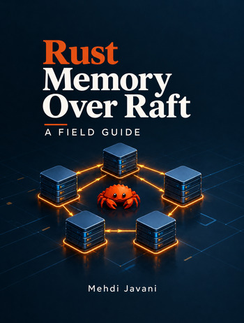

  

---

# Rust Memory Over Raft: A Field Guide

**A field guide to building reliable, in-memory distributed systems in Rust on top of Raft.**

Most Raft books teach the protocol. This one is about the system that lives around it — the decisions that determine whether a replicated application actually keeps its promises, and the ones that only become visible when you try.

If you are about to build a service that owns its state in memory, replicates it across a cluster, and answers clients without a database or a broker in the hot path, this book is for you. If you have built one and you are not sure it is right, it is also for you.

## Download

The book is free. The current version is **1.0**.

**[Download the PDF](https://github.com/m-javani/rust-memory-over-raft/releases/latest/download/rust-memory-over-raft.pdf)**

The PDF is the book. There is no source repo for the text; corrections land in the next release.

## What the book covers

The first part builds the foundation: storage, the Raft Core, and snapshots — the pieces every implementation has to get right.

The second part is the application: the state machine and the one component that owns it, the network that connects nodes before any consensus exists, the cluster that forms on top of it, rejoining and catch-up, the promises a read and a write actually make, and the operations that change a cluster without breaking it.

Every chapter names what Raft requires, what the library expects, and what the application must decide. The distinction is the book's discipline, and it is where most of the bugs live.

## Who it is for

Engineers who have decided the application should own its state, and are about to build the system around it. Engineers who have built one and are re-reading the design against what the protocol actually says. Engineers who are evaluating whether their system's promise to their clients matches what their system actually delivers.

It is not a tutorial on Raft. It assumes you have read, or will read, the protocol books. It is not a Rust tutorial. It assumes you can write the language.

## Feedback

If you find a typo, a technical mistake, or a place where the explanation could be clearer, please [open an issue](https://github.com/m-javani/rust-memory-over-raft/issues). Corrections are collected and appear in the next release.

## License

The text is licensed under [CC BY 4.0](https://creativecommons.org/licenses/by/4.0/). Code snippets in the book are licensed under MIT.